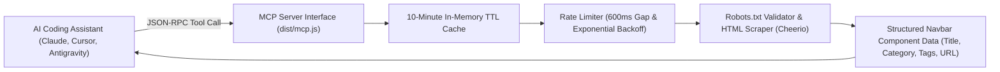

# 🧭 Navbar Gallery Model Context Protocol (MCP) Server

[](https://modelcontextprotocol.io/)
[](https://www.typescriptlang.org/)
[](https://nodejs.org/)
[](LICENSE)

An intelligent Model Context Protocol (MCP) server and CLI for querying, searching, and previewing curated navigation bar components from [navbar.gallery](https://www.navbar.gallery). Built for AI coding assistants (Claude Desktop, Cursor, Antigravity) to inject real-world UI design inspiration directly into coding sessions.

---

## 📐 System Architecture



---

## 🌟 Key Features

1. **Seamless AI Assistant Integration:**
   * Exposes native MCP tools (`list_types`, `list_navbars`, `search_navbars`, `get_navbar`) for instant query-driven design inspiration.

2. **Built-in Scraping Safety & Etiquette:**
   * **Robots.txt Compliant:** Strictly respects `robots.txt` paths.
   * **Rate-Limited:** 600ms gap between live requests with 2 automatic retries on rate limits or network hiccups.
   * **In-Memory Caching:** 10-minute cache prevents redundant queries to upstream endpoints.

3. **Dual Interface (CLI + MCP):**
   * Can be used as a standalone terminal CLI (`node dist/cli.js search stripe`) or as an autonomous MCP background server.

---

## 🚀 Setup & Build

```bash
# Install dependencies & build TypeScript
npm install
npm run build

# CLI Testing:
node dist/cli.js list dropdowns
node dist/cli.js search stripe --type all
```

### Claude Desktop / Antigravity MCP Configuration:
```json
{
  "mcpServers": {
    "navbar-gallery": {
      "command": "node",
      "args": [
        "C:\\path\\to\\navbar-gallery-mcp\\dist\\mcp.js"
      ]
    }
  }
}
```

---

## ⚖️ Intellectual Property & License

**Copyright (c) 2026 Kartik. All Rights Reserved.**

This repository and its source code are published for **viewing, evaluation, and portfolio demonstration purposes only**. No permission is granted to reproduce, distribute, modify, deploy, or commercially exploit this software. See the [LICENSE](LICENSE) file for complete legal terms.
